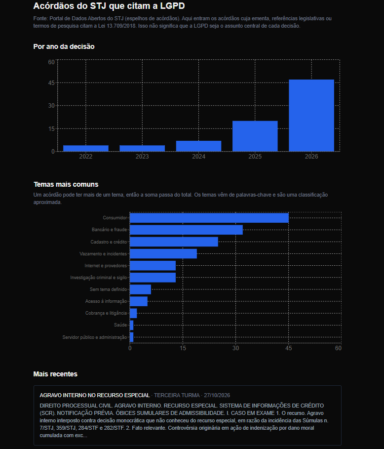

# Observatório Jurídico

Pipeline de dados que coleta, organiza e analisa decisões judiciais brasileiras sobre **proteção de dados pessoais (LGPD)**, usando duas fontes públicas: a API do DataJud (CNJ) e o Portal de Dados Abertos do STJ.

> Projeto de portfólio em desenvolvimento, feito para praticar engenharia de dados, bancos de dados e arquitetura de software.

## O que já funciona

- Banco PostgreSQL rodando em Docker, com tabelas de tribunais, processos, assuntos, coletas e acórdãos
- Coleta de processos dos tribunais estaduais na API do DataJud (assunto "Proteção de Dados Pessoais"), com paginação, novas tentativas e tratamento de erros
- Histórico de cada coleta (quando rodou, quantos processos, se terminou ou parou no meio)
- Download automático dos "espelhos de acórdãos" do STJ (mais de 200 mil acórdãos, 10 órgãos julgadores) e filtro que separa os que citam a LGPD
- Gravação dos dados no banco sem duplicar registros
- API em FastAPI que entrega as análises em JSON
- Dashboard em Next.js com status das coletas e gráficos por ano, tribunal, assunto, classe e acórdãos do STJ
- Classificação dos acórdãos por tema (consumidor, bancário, crédito, vazamento, internet etc.) com regras de palavras-chave
- Busca por texto nas ementas, com destaque dos termos encontrados

## Stack

PostgreSQL · Docker Compose · Python (requests, psycopg, FastAPI) · SQL · Next.js · Tailwind · Recharts

## Fontes de dados

- [API Pública do DataJud](https://datajud-wiki.cnj.jus.br/api-publica/) (CNJ): metadados de processos
- [Portal de Dados Abertos do STJ](https://dadosabertos.web.stj.jus.br/): espelhos de acórdãos, licença Creative Commons Atribuição

## Primeiras observações

**Processos dos tribunais estaduais** (amostra de cerca de 440 processos de 6 tribunais):

- A quantidade de processos por ano de ajuizamento cresce de 2021 a 2026
- Os assuntos que mais acompanham "Proteção de Dados Pessoais" são Direito de Imagem, Dano Moral e Privacidade
- A maioria dos casos é cível de primeira instância

**Acórdãos do STJ** (201.792 acórdãos únicos, de maio de 2022 a outubro de 2026):

- 82 citam a Lei 13.709/2018 (LGPD) e outros 120 apenas mencionam "dados pessoais"
- Os que citam a lei vêm principalmente da Terceira e da Quarta Turma, que julgam direito privado
- A quantidade por ano de decisão também cresce: 4 em 2022, 4 em 2023, 7 em 2024, 20 em 2025 e 47 em 2026 (2022 e 2026 são anos incompletos na base)
- Dos 82 acórdãos que citam a LGPD, os temas mais comuns são Consumidor (45), Bancário e fraude (32), Cadastro e crédito (25) e Vazamento e incidentes (19). Os dois conjuntos de dados (processos estaduais e acórdãos do STJ) apontam para o mesmo tipo de disputa: relações de consumo, e não vazamento em si
## Limitações

- A API pública do DataJud é instável (erros 429 e 504) e às vezes devolve resultados parciais, então os dados dos tribunais estaduais são uma **amostra** e não o total
- O DataJud entrega apenas metadados, sem o texto das decisões
- No STJ, "citar a LGPD" significa que a lei aparece na ementa, nas referências legislativas ou nos termos de pesquisa. Isso **não quer dizer** que a LGPD seja o tema central do acórdão
- O filtro usa palavras-chave e pode errar nos dois sentidos (deixar passar casos ou incluir casos pouco relacionados)
- Um dos arquivos do STJ (Segunda Seção, fevereiro de 2024) veio com erro de formatação na fonte e foi ignorado
- Só os metadados e a ementa dos acórdãos são guardados, não o texto integral
- Os temas vêm de palavras-chave, então são uma classificação aproximada: um acórdão pode ter mais de um tema e 6 dos 82 ficaram sem tema definido
- A busca por texto cobre só as ementas (não o texto integral) e exige as palavras com acento
## Como rodar

1. Clone o repositório e crie o ambiente: `python -m venv .venv`, ative-o e rode `pip install -r requirements.txt`
2. Copie `.env.example` para `.env` e preencha (a chave pública do DataJud está na wiki do CNJ)
3. Suba o banco: `docker compose up -d`
4. Execute os arquivos da pasta `banco` em ordem (01 a 08)
5. Coleta dos tribunais estaduais: `python src/carregar_processos.py`
6. Acórdãos do STJ: `python src/baixar_acordaos_stj.py`, depois `python src/carregar_acordaos.py` e `python src/classificar_temas.py`
7. Suba a API: `python -m uvicorn src.api:app --reload`
8. Suba o site: entre na pasta `web`, rode `npm install` e depois `npm run dev`

## Qualidade e fluxo de trabalho

- Testes automatizados com pytest (filtro de LGPD e classificação por tema)
- GitHub Actions roda os testes em cada pull request e em cada push na main
- A branch main é protegida: só recebe mudanças por pull request com os testes passando

## Próximos passos

- Testes automatizados para o filtro de LGPD e a classificação por tema
- Coleta em segundo plano, com agendamento automático
- Ampliar os tribunais estaduais cobertos
- Refinar os temas olhando os acórdãos sem classificação
