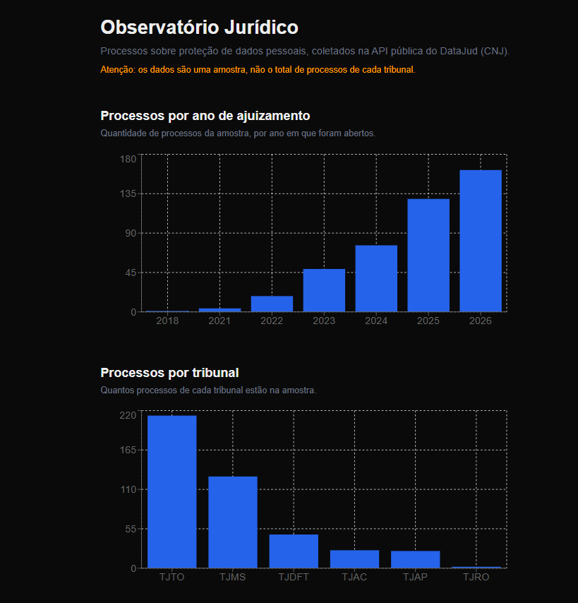

# Observatório Jurídico

Pipeline de dados que coleta, organiza e analisa processos judiciais brasileiros sobre **proteção de dados pessoais (LGPD)**, usando a API pública do DataJud (CNJ).

> Projeto de portfólio em desenvolvimento, feito para praticar engenharia de dados, bancos de dados e arquitetura de software.

## O que já funciona

- Banco PostgreSQL rodando em Docker, com tabelas de tribunais, processos, assuntos, decisões e coletas
- Script em Python que busca processos na API do DataJud (assunto "Proteção de Dados Pessoais"), com paginação, novas tentativas e tratamento de erros
- Gravação dos dados no banco sem duplicar registros
- Histórico de cada coleta (quando rodou, quantos processos, se terminou ou parou no meio)
- Consultas SQL de análise (`banco/analises.sql`)
- API em FastAPI que entrega as análises em JSON
- Dashboard em Next.js com status das coletas e gráficos por ano, tribunal, assunto e classe

## Stack

PostgreSQL · Docker Compose · Python (requests, psycopg, FastAPI) · SQL · Next.js · Tailwind · Recharts

## Primeiras observações

Na amostra coletada (439 processos de 6 tribunais estaduais, em novembro de 2026):

- A quantidade de processos por ano de ajuizamento cresce de 2021 a 2026
- Os assuntos que mais acompanham "Proteção de Dados Pessoais" são Direito de Imagem, Dano Moral e Privacidade
- A maioria dos casos é cível de primeira instância

## Limitações

- A API pública do DataJud é instável (erros 429 e 504) e às vezes devolve resultados parciais, então os dados são uma **amostra** e não o total de processos
- A API entrega apenas metadados, sem o texto das decisões
- Alguns tribunais retornaram poucos ou nenhum processo com esse assunto

## Como rodar

1. Clone o repositório e crie o ambiente: `python -m venv .venv` e `pip install -r requirements.txt`
2. Copie `.env.example` para `.env` e preencha (a chave pública do DataJud está na wiki do CNJ)
3. Suba o banco: `docker compose up -d`
4. Execute os arquivos da pasta `banco` em ordem (01 a 05)
5. Rode a coleta: `python src/carregar_processos.py`
6. Suba a API: `python -m uvicorn src.api:app --reload`
7. Suba o site: entre na pasta `web`, rode `npm install` e depois `npm run dev`

## Próximos passos

- Textos de decisões a partir de outra fonte
- Classificação por tema e busca
- Coleta em segundo plano, com agendamento automático